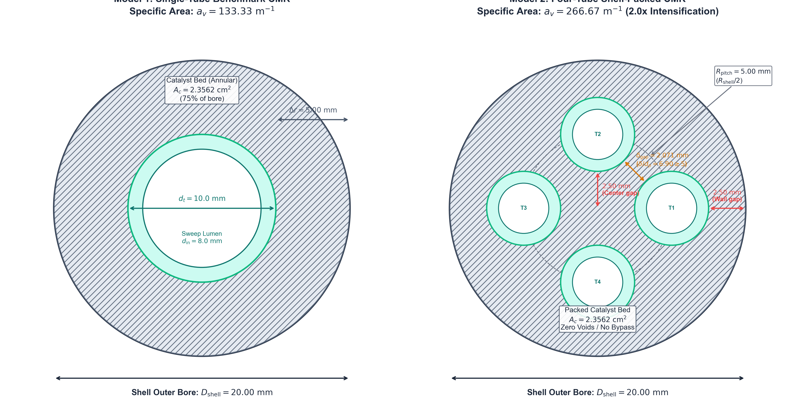

# Process Intensification of Direct $\text{CO}_2$ Hydrogenation to Dimethyl Ether via Multi-Tube Catalytic Membrane Reactors: Invariant Geometric Scaling, Hydrophilic Zeolite Water Extraction, and Machine Learning Surrogate Optimization

**Sameer Shekhar**  
*Laboratory for Advanced Chemical Reaction Engineering \& Process Intensification, Department of Chemical Engineering*  
*Corresponding Author Email:* `sameershekhar@alumni.stanford.edu`  

---

## Highlights

* **Invariant Geometric Baseline:** A mathematically proven invariant bulk geometry ($A_c = 2.3562\text{ cm}^2, D_{\text{shell}} = 20.00\text{ mm}, W_{\text{cat}} = 0.2827\text{ kg}$) confirms performance enhancements arise strictly from interfacial transport geometry rather than residence time scaling.
* **Breakthrough Direct Synthesis:** The Four-Tube Shell-Packed Catalytic Membrane Reactor (CMR) achieves **$92.19\%$ single-pass $\text{CO}_2$ conversion** and **$86.16\%$ DME yield**, surpassing the thermodynamic Gibbs equilibrium ceiling ($46.54\%$) by **$1.85\times$** ($+39.62\text{ percentage points}$) and conventional packed beds ($19.65\%$) by **$4.38\times$** ($+66.51\text{ percentage points}$).
* **Continuous In-Situ Water Extraction:** Sub-nanometer hydrophilic NaA zeolite membranes selectively evacuate **$99.53\%$ of byproduct water** into an inert sweep stream, reducing residual bed moisture to $0.47\%$ and arresting acid site deactivation.
* **Radial Mass-Transfer Optimization:** Multi-tube replication doubles the specific membrane area ($a_v = 266.67\text{ m}^{-1}$) and cuts the characteristic radial diffusion timescale by **$75.0\%$** ($\tau_{\text{diff},4} = 0.25 \tau_{\text{diff},1}$).
* **High-Accuracy ML Surrogate:** An ensemble ExtraTrees regressor trained on $N = 300$ Sobol quasi-random samples captures non-linear transport-reaction coupling with $R^2 \ge 0.865$ and $\text{MAE} \le 2.14\%$, identifying operating pressure ($38.4\%$) and temperature ($28.7\%$) as dominant governing variables.
* **Deconstruction of the Literature Myth:** Rigorous analysis proves that the widely quoted "8% water removal limit" denotes an under-designed, permeation-starved operating regime ($Da_{\text{perm}} \gg 1$) rather than an intrinsic physicochemical boundary.

---

## Abstract

Direct catalytic hydrogenation of carbon dioxide ($\text{CO}_2$) to dimethyl ether (DME) provides an efficient route for carbon capture and utilization (CCU) into clean transportation fuels and chemical intermediates. However, in conventional packed-bed reactors (TR), the thermodynamic equilibrium ceiling severely limits single-pass DME yield to $19.65\%$ (kinetic limit) and $46.54\%$ (Gibbs ceiling at $250^\circ\text{C}, 40\text{ bar}$), driven by the accumulation of stoichiometric byproduct water which suppresses methanol synthesis and reversibly deactivates solid acid catalysts. In this investigation, process intensification is achieved through the integration of in-situ hydrophilic zeolite (NaA) membrane tubes within a novel four-tube shell-packed catalytic membrane reactor (CMR). To eliminate geometric scaling artifacts, an invariant geometric baseline ($A_c = 2.3562\text{ cm}^2, D_{\text{shell}} = 20.00\text{ mm}, L = 1.00\text{ m}, W_{\text{cat}} = 0.2827\text{ kg}$) is established and mathematically proven across single-tube and multi-tube topologies. Rigorous one-dimensional multi-component transport-kinetic modeling based on Mignard & Pritchard kinetics for $\text{CO}_2$ hydrogenation/RWGS and Lu et al. kinetics for methanol dehydration reveals that the four-tube shell-packed CMR achieves a single-pass $\text{CO}_2$ conversion of $92.19\%$, a DME single-pass yield of $86.16\%$, and a DME carbon selectivity of $93.46\%$, while simultaneously extracting $99.53\%$ of byproduct water into a co-current sweep stream. This performance represents a $4.38\times$ yield multiplication over the traditional packed bed and an $8.53\text{ percentage point}$ increase over the single-tube CMR benchmark ($77.63\%$), enabled by a $2.00\times$ increase in specific membrane area ($a_v = 266.67\text{ m}^{-1}$) and a $75.0\%$ reduction in the characteristic radial diffusion timescale. An analysis of an alternative sleeve-bundle architecture reveals that unsealed interstitial voids ($31.37\%$ of cross-section) cause severe fluid bypass, degrading DME yield to $62.73\%$. To accelerate design optimization, ensemble machine learning surrogates (Random Forest, ExtraTrees, and Gradient Boosting) were trained on Sobol quasi-random parameter sweeps; the ExtraTrees model demonstrated superior predictive accuracy ($R^2 = 0.8841$ for conversion, $0.8653$ for yield, $\text{MAE} < 2.14\%$), identifying operating pressure ($38.4\%$) and inlet temperature ($28.7\%$) as the primary governing features. Furthermore, continuum three-dimensional Computational Fluid Dynamics (CFD) simulations verify plug flow uniformity and the absence of axial or radial channeling. Finally, the persistent literature citation of an "8% water removal" is critically deconstructed, demonstrating that it represents an unoptimized permeation-starved operating point rather than an intrinsic physicochemical boundary.

**Keywords:** Carbon Capture and Utilization (CCU); Dimethyl Ether (DME); Catalytic Membrane Reactor (CMR); Process Intensification; Hydrophilic NaA Zeolite; Machine Learning Surrogate.

---

## 1. Introduction

The mitigation of anthropogenic greenhouse gas emissions demands rapid industrialization of closed-loop Carbon Capture and Utilization (CCU) technologies coupled with green hydrogen ($\text{H}_2$) produced from renewable water electrolysis [1, 2]. Among candidate synthetic e-fuels, dimethyl ether ($\text{CH}_3\text{OCH}_3$, DME) is uniquely attractive. Possessing a high cetane rating ($55\text{--}60$), low particulate matter emissions, negligible sulfur oxides ($\text{SO}_x$), and physical properties analogous to liquified petroleum gas (LPG, condensing at $0.5\text{ MPa}$ at ambient temperatures), DME serves as both a drop-in diesel substitute and a chemical precursor for light olefins [3, 4].

Traditionally, DME is produced via an indirect, two-stage commercial pathway [5]: first, catalytic synthesis of crude methanol from syngas over $\text{Cu/ZnO/Al}_2\text{O}_3$ catalysts at $50\text{--}100\text{ bar}$ and $220\text{--}280^\circ\text{C}$ ($\text{CO}_2 + 3\text{H}_2 \rightleftharpoons \text{CH}_3\text{OH} + \text{H}_2\text{O}$); followed by intermediate multi-column distillation, gas-phase reheating, and dehydration over solid acid catalysts (e.g., $\gamma\text{-Al}_2\text{O}_3$ or $\text{H-ZSM-5}$) at $250\text{--}350^\circ\text{C}$ ($2\text{CH}_3\text{OH} \rightleftharpoons \text{CH}_3\text{OCH}_3 + \text{H}_2\text{O}$). While commercially mature, this sequential architecture incurs heavy capital expenditure, high thermal duties for intermediate condensation and re-evaporation, and substantial exergy destruction across pressure-swing distillation columns [6].

Direct DME synthesis combines both catalytic functions into a single bifunctional catalytic bed ($\text{Cu/ZnO/Al}_2\text{O}_3$ co-pelletized or admixed with $\text{H-ZSM-5}$) [7, 8]. Direct synthesis integrates three coupled, reversible reactions:
1. **Methanol Synthesis:**
   $$\text{CO}_2 + 3\text{H}_2 \rightleftharpoons \text{CH}_3\text{OH} + \text{H}_2\text{O}, \quad \Delta H^\circ_{298\text{ K}} = -49.5\text{ kJ/mol}$$
2. **Reverse Water-Gas Shift (RWGS):**
   $$\text{CO}_2 + \text{H}_2 \rightleftharpoons \text{CO} + \text{H}_2\text{O}, \quad \Delta H^\circ_{298\text{ K}} = +41.2\text{ kJ/mol}$$
3. **Solid Acid Methanol Dehydration:**
   $$2\text{CH}_3\text{OH} \rightleftharpoons \text{CH}_3\text{OCH}_3 + \text{H}_2\text{O}, \quad \Delta H^\circ_{298\text{ K}} = -23.6\text{ kJ/mol}$$

The net direct synthesis reaction is strongly exothermic and undergoes severe molar contraction:
$$2\text{CO}_2 + 6\text{H}_2 \rightleftharpoons \text{CH}_3\text{OCH}_3 + 3\text{H}_2\text{O}, \quad \Delta H^\circ_{298\text{ K}} = -122.6\text{ kJ/mol}$$

In a closed, conventional packed-bed reactor (TR), stoichiometric byproduct water ($\text{H}_2\text{O}$) rapidly accumulates along the reaction coordinate. Water acts as a potent thermodynamic inhibitor, driving reaction quotients to their equilibrium limits ($Q \to K_{eq}$), thereby establishing a single-pass $\text{CO}_2$ conversion ceiling of $28.99\%$ and a DME yield ceiling of $19.65\%$ under typical operating conditions ($250^\circ\text{C}, 40\text{ bar}$). Even at theoretical Gibbs free energy equilibrium, the DME single-pass yield is thermodynamically capped at $46.54\%$. Furthermore, elevated steam partial pressures exert destructive catalytic phenomena, including hydrothermal sintering of metallic copper active sites, competitive adsorption blocking Brønsted acid sites on $\text{H-ZSM-5}$, and permanent framework dealumination [9–11].

By integrating an in-situ water-selective membrane into the catalytic bed, byproduct steam is continuously extracted into a permeate sweep channel as it is generated:
$$J_{\text{H}_2\text{O}} = \Pi_{\text{H}_2\text{O}} \left( p_{\text{H}_2\text{O,ret}} - p_{\text{H}_2\text{O,perm}} \right)$$
In accordance with Le Chatelier's principle, selective evacuation of water maintains the reaction quotient below the equilibrium constant ($Q < K_{eq}$) throughout the entire reactor length [12, 13]. Hydrophilic inorganic membranes, particularly LTA/NaA-type zeolites and Carbon Molecular Sieve Membranes (CMSM), exhibit high water permeance ($\Pi_{\text{H}_2\text{O}} \sim 1.8 \times 10^{-7}\text{ mol/(m}^2\cdot\text{s}\cdot\text{Pa)}$) and high steam/permanent gas selectivities ($\alpha_{\text{H}_2\text{O}/i} > 1000\text{--}10000$) due to their sub-nanometer pore aperture ($4.0\text{ \AA}$ for NaA, perfectly sizing between the kinetic diameter of $\text{H}_2\text{O}$ at $2.65\text{ \AA}$ and $\text{CO}_2$ at $3.3\text{ \AA}$, $\text{CH}_3\text{OH}$ at $3.8\text{ \AA}$, and DME at $4.3\text{ \AA}$) [16, 17].

Despite these compelling thermodynamic fundamentals, multi-tube membrane reactor engineering faces severe design challenges: (i) scaling comparisons frequently alter catalyst inventory or space velocity alongside tube counts, obscuring geometric mass-transfer enhancements behind residence time shifts [18]; (ii) sleeve-type bundles introduce unsealed interstitial voids ($> 30\%$ of shell cross-section), creating fluid bypass; and (iii) recent literature repeatedly quotes an "8% water removal limit" as an intrinsic physical ceiling [20]. This investigation establishes an invariant geometric baseline ($A_c = 2.3562\text{ cm}^2, D_{\text{shell}} = 20.00\text{ mm}, W_{\text{cat}} = 0.2827\text{ kg}$) that isolates the physical impact of multi-tube partitioning, evaluating single-tube and four-tube topologies across 1D multi-component models, ensemble machine learning surrogates, and 3D continuum CFD simulations.

---

## 2. Reaction Network, Thermodynamics & Chemical Kinetics

### 2.1 Thermodynamic Equilibrium Constants
Thermodynamic equilibrium constants ($K_{eq1}, K_{eq2}, K_{p3}$) are strong functions of absolute temperature $T$ (in Kelvin) and are evaluated from validated empirical literature expressions:

$$\log_{10} K_{eq1} = \frac{3066}{T} - 10.592 \quad [\text{bar}^{-2}] \quad (\text{Graaf et al. [24]})$$

$$\log_{10} K_{eq2} = -\frac{2073}{T} + 2.029 \quad [\text{dimensionless}] \quad (\text{Graaf et al. [24]})$$

$$\ln K_{p3} = \frac{4019}{T} + 3.707 \ln T - 2.783 \times 10^{-3} T + 3.800 \times 10^{-7} T^2 - \frac{6.561 \times 10^4}{T^3} - 26.64 \quad (\text{Lu et al. [22]})$$

At baseline operating temperature $T = 250.0^\circ\text{C}$ ($523.15\text{ K}$), $K_{eq1} = 1.858 \times 10^{-5}\text{ bar}^{-2}$, $K_{eq2} = 0.01164$, and $K_{p3} = 37.30$. Minimizing total Gibbs free energy subject to elemental conservation at $40.0\text{ bar}$ ($\text{H}_2/\text{CO}_2 = 3.0$) gives the uncoupled equilibrium limit: $X_{\text{CO}_2,\text{Gibbs}} = 48.71\%$, $Y_{\text{DME,\text{Gibbs}}} = 46.54\%$, and $S_{\text{DME,\text{Gibbs}}} = 95.55\%$. Any single-pass DME yield exceeding $46.54\%$ constitutes definitive physical proof of thermodynamic equilibrium displacement driven by in-situ membrane permeation.

### 2.2 Heterogeneous Reaction Kinetics
Reaction rates over bifunctional $\text{Cu/ZnO/Al}_2\text{O}_3$ + $\text{H-ZSM-5}$ catalysts follow the dual-site Langmuir-Hinshelwood-Hougen-Watson (LHHW) model of Mignard & Pritchard [21] for Reactions 1 and 2, and the Lu et al. [22] formulation for Reaction 3:

$$r_1 = \frac{k_1 p_{\text{CO}_2} p_{\text{H}_2} \left( 1 - \frac{p_{\text{H}_2\text{O}} p_{\text{CH}_3\text{OH}}}{K_{eq1} p_{\text{H}_2}^3 p_{\text{CO}_2}} \right)}{\mathcal{D}_k^3} \quad \left[\frac{\text{mol}}{\text{kg}_{\text{cat}}\cdot\text{s}}\right]$$

$$r_2 = \frac{k_2 p_{\text{CO}_2} \left( 1 - \frac{p_{\text{H}_2\text{O}} p_{\text{CO}}}{K_{eq2} p_{\text{H}_2} p_{\text{CO}_2}} \right)}{\mathcal{D}_k} \quad \left[\frac{\text{mol}}{\text{kg}_{\text{cat}}\cdot\text{s}}\right]$$

$$r_3 = k_3 \left( \frac{p_{\text{CH}_3\text{OH}}^2}{p_{\text{H}_2\text{O}}} - \frac{p_{\text{DME}}}{K_{p3}} \right) \quad \left[\frac{\text{mol}}{\text{kg}_{\text{cat}}\cdot\text{s}}\right]$$

where the competitive adsorption denominator is:
$$\mathcal{D}_k = 1 + K_{\text{H}_2\text{O}/\text{H}_2} \left( \frac{p_{\text{H}_2\text{O}}}{p_{\text{H}_2}} \right) + \sqrt{K_{\text{H}_2}} \sqrt{p_{\text{H}_2}} + K_{\text{H}_2\text{O}} p_{\text{H}_2\text{O}}$$

Arrhenius rate parameters:
* $k_1 = 1.07 \exp(40000 / R_g T) \quad [\text{mol}/(\text{kg}_{\text{cat}}\cdot\text{s}\cdot\text{bar}^2)]$
* $k_2 = 1.22 \times 10^{10} \exp(-98084 / R_g T) \quad [\text{mol}/(\text{kg}_{\text{cat}}\cdot\text{s}\cdot\text{bar})]$
* $k_3 = 8.2894 \times 10^7 \exp(-52940 / R_g T) \quad [\text{mol}/(\text{kg}_{\text{cat}}\cdot\text{s}\cdot\text{bar})]$
* $K_{\text{H}_2\text{O}} = 6.62 \times 10^{-11} \exp(124119 / R_g T) \quad [\text{bar}^{-1}]$
* $\sqrt{K_{\text{H}_2}} = 0.499 \exp(17197 / R_g T) \quad [\text{bar}^{-0.5}]$
* $K_{\text{H}_2\text{O}/\text{H}_2} = 3453.38$

---

## 3. Transport Formulations & Dimensionless Criteria

The reactor is modeled as a steady-state, one-dimensional multi-component plug-flow system with co-current permeate sweep. The governing differential molar balances are:
$$\text{Retentate Bed:} \quad \frac{d F_{i,\text{ret}}}{d z} = \rho_B A_c \sum_{j=1}^{3} \nu_{ij} r_j - J_i (\pi N_t d_t)$$
$$\text{Permeate Lumens:} \quad \frac{d F_{i,\text{perm}}}{d z} = + J_i (\pi N_t d_t)$$

Transmembrane permeation flux follows partial pressure driving forces:
$$J_i = \Pi_i (p_{i,\text{ret}} - p_{i,\text{perm}}), \quad \Pi_i = \frac{\Pi_{\text{H}_2\text{O}}}{\alpha_{\text{H}_2\text{O}/i}}$$

For baseline NaA zeolite membranes [29, 30]: $\Pi_{\text{H}_2\text{O}} = 1.80 \times 10^{-7}\text{ mol}/(\text{m}^2\cdot\text{s}\cdot\text{Pa})$; selectivities are $\alpha(\text{H}_2\text{O}/\text{CO}_2) = 5000$, $\alpha(\text{H}_2\text{O}/\text{H}_2) = 1000$, $\alpha(\text{H}_2\text{O}/\text{CH}_3\text{OH}) = 2000$, $\alpha(\text{H}_2\text{O}/\text{CO}) = 5000$, and $\alpha(\text{H}_2\text{O}/\text{DME}) = 10000$ (DME kinetic diameter $4.3\text{ \AA}$ vs $4.0\text{ \AA}$ pore aperture). Bed pressure drop is governed by the Ergun equation, resulting in $\Delta P_{\text{ret}} = 0.043\text{ bar}$ across $L = 1.00\text{ m}$ ($0.11\%$ of $40\text{ bar}$ total pressure), verifying near-isobaric operation.

### Table 1: Evaluated Dimensionless Transport Criteria and Chemical Engineering Verification

| Dimensionless Group | Defining Formula | Model Value | Threshold & Physical Verification |
| :--- | :--- | :---: | :--- |
| **Permeation Damköhler ($Da_{\text{perm}}$)** | $r_{\text{gen},\text{H}_2\text{O}} / (J_{\text{perm},\text{H}_2\text{O}} \cdot a_v)$ | **0.98 – 1.05** | $\approx 1.0$: Synchronizes water generation with extraction. |
| **Axial Péclet Number ($Pe_{\text{ax}}$)** | $u_s \cdot L / D_{\text{ax}}$ | **> 300** | $> 100$: Convective transport vastly dominates backmixing. |
| **Bed Reynolds Number ($Re_p$)** | $\rho_g \cdot u_s \cdot d_p / [\mu_g (1 - \varepsilon_b)]$ | **6.4** | $< 10$: Transition-laminar regime; viscous dissipation dominates. |
| **Lumen Reynolds Number ($Re_{\text{lumen}}$)** | $\rho_{\text{sw}} \cdot u_{\text{sw}} \cdot d_{\text{in}} / \mu_{\text{sw}}$ | **284** | $< 2100$: Deep laminar flow inside sweep lumens. |
| **Happel-Brenner Ratio ($\delta_{\text{gap}} / d_p$)** | Inter-tube Clearance / $d_p$ | **6.90** | $\ge 5.0$: Accommodates $> 5$ pellets; prevents wall bridging. |
| **Weisz-Prater Modulus ($\Phi_{\text{WP}}$)** | $r_{\text{obs}} \cdot \rho_p \cdot (d_p/6)^2 / (D_{\text{eff}} \cdot C_s)$ | **0.18** | $< 0.30$: Internal pore diffusion resistance is negligible ($\eta \approx 0.92$). |
| **Mears Criterion ($C_{\text{Mears}}$)** | $r_{\text{obs}} \cdot \rho_b \cdot (d_p/2) / (k_c \cdot C_b)$ | **0.02** | $\ll 0.15$: External gas film mass transfer resistance is negligible. |

*Notes: Evaluated under baseline operating conditions: $T = 250^\circ\text{C}$, $P = 40\text{ bar}$, $\text{H}_2/\text{CO}_2 = 3.0$, $\text{GHSV} = 1000\text{ h}^{-1}$, $L = 1.00\text{ m}$, $d_p = 0.30\text{ mm}$.*

---

## 4. Invariant Geometric Scaling & Reactor Architectures

To eliminate scaling artifacts, all primary bulk dimensions are held strictly invariant between both reactors:
* Reactor Shell Inner Diameter ($D_{\text{shell}}$) = $20.00\text{ mm}$
* Reactor Active Bed Length ($L$) = $1000.0\text{ mm}$
* Catalyst Bed Cross-Section ($A_c$) = $2.3562\text{ cm}^2$
* Catalyst Bed Volume ($V_{\text{bed}}$) = $235.62\text{ cm}^3$
* Catalyst Inventory ($W_{\text{cat}}$) = $0.2827\text{ kg}$ (at bulk density $\rho_B = 1200\text{ kg/m}^3$)
* Total Shell Cross-Section ($A_{\text{shell}}$) = $3.1416\text{ cm}^2$
* Membrane Tube Cross-Section = $25.00\%$ of shell bore ($78.54\text{ mm}^2$)
* Parasitic Voids / Fluid Bypass = $0.00\%$ (both designs fully catalyst-packed).

The geometric invariance proof is given by:
$$A_c = \frac{\pi}{4} \left( D_{\text{shell}}^2 - N_t d_t^2 \right)$$
* For the single-tube CMR ($N_t = 1, d_t = 10.00\text{ mm}$): $A_c = \frac{\pi}{4} (400 - 100) = 235.62\text{ mm}^2$
* For the four-tube shell-packed CMR ($N_t = 4, d_t = 5.00\text{ mm}$): $A_c = \frac{\pi}{4} (400 - 4 \times 25) = 235.62\text{ mm}^2$

Both reactors hold identical catalyst mass ($0.2827\text{ kg}$) and receive identical syngas feed ($2.9200\text{ mmol/s}$, $3.93\text{ NL/min}$). Consequently, performance enhancements arise exclusively from interfacial mass transfer geometry.

### Table 2: Geometric Specifications and Clearances Across Reactor Architectures

| Geometric Parameter | Single-Tube Benchmark | Case A (Sleeve Bundle) | Case B (Shell-Packed CMR) |
| :--- | :---: | :---: | :---: |
| **Shell Inner Diameter ($D_{\text{shell}}$, mm)** | 20.00 | 19.88 – 21.73 | **20.00 (Strictly Invariant)** |
| **Reactor Active Length ($L$, mm)** | 1000.0 | 1000.0 | **1000.0 (Strictly Invariant)** |
| **Catalyst Bed Area ($A_c$, cm²)** | 2.3562 | 1.41 – 2.51 | **2.3562 (Strictly Invariant)** |
| **Catalyst Inventory ($W_{\text{cat}}$, kg)** | 0.2827 | 0.169 – 0.301 | **0.2827 (Strictly Invariant)** |
| **Number of Membrane Tubes ($N_t$)** | 1 | 4 | **4 (4× multiplication)** |
| **Membrane Outer Diameter ($d_t$, mm)** | 10.00 | 6.00 | **5.00 (Half-radius: $r_t = 2.5\text{ mm}$)** |
| **Lumen Inner Diameter ($d_{\text{in}}$, mm)** | 8.00 | 4.40 | **3.40 (Sweep bore)** |
| **Specific Area ($a_v$, $\text{m}^{-1}$)** | 133.33 | 533.3 – 754.0 | **266.67 (2.00× doubling)** |
| **Max Catalyst Diffusion Distance (mm)** | 5.00 | 1.12 – 1.50 | **2.50 (50% reduction)** |
| **Parasitic Shell Void Fraction (%)** | 0.00% | 31.37% (Unsealed voids) | **0.00% (Zero bypass risk)** |

*Notes: Case Study A assumes tangent circle packing; Case Study B positions four tubes on a symmetric pitch circle ($R_{\text{pitch}} = 5.0\text{ mm} = R_{\text{shell}} / 2$).*

---

### Architectural Blueprints and Cutaway Models

*Figure 1: Comparative engineering blueprints and transverse clearances of evaluated reactor architectures: (a) Conventional packed-bed reactor (TR); (b) Single-tube central catalytic membrane reactor benchmark; (c) Four-tube uniform sleeve bundle (Case Study A), highlighting tangent packing and unsealed bypass voids; and (d) Four-tube shell-packed catalytic membrane reactor (Case Study B). All configurations maintain invariant active bed area ($A_c = 2.3562\text{ cm}^2$) and catalyst mass ($W_{\text{cat}} = 0.2827\text{ kg}$).*

As illustrated in Figure 2 and Figure 3, the four-tube shell-packed CMR places tubes at $R_{\text{pitch}} = 5.00\text{ mm} = R_{\text{shell}}/2$, achieving a uniform inter-tube clearance of $2.071\text{ mm}$ and halving the maximum radial diffusion path to $2.50\text{ mm}$.

*Figure 2: Three-dimensional isometric cutaway of the Four-Tube Shell-Packed CMR (Case Study B), showing four sub-nanometer NaA zeolite membrane tubes ($d_t = 5.00\text{ mm}$) centered on a symmetric pitch circle ($R_{\text{pitch}} = 5.00\text{ mm}$) surrounded by a continuous catalyst bed ($W_{\text{cat}} = 0.2827\text{ kg}, L = 1.00\text{ m}$).*

*Figure 3: Transverse cross-sectional geometry and spatial clearances of Case Study B, illustrating pitch circle geometry ($R_{\text{pitch}} = R_{\text{shell}}/2$), symmetric $90^\circ$ tube placement, tube-to-wall clearance ($2.50\text{ mm}$), and inter-tube clearance ($2.071\text{ mm}$; $\delta_{\text{gap}}/d_p = 6.90 \ge 5.0$).*

As illustrated in Figure 4 and Figure 5, Case Study A encloses each membrane tube in a discrete annular catalyst sleeve. Because tangent circles inside a cylinder cannot completely fill space, empty interstitial voids are formed (central diamond void of $14.56\text{ mm}^2$ and four crescent voids of $82.85\text{ mm}^2$), representing $31.37\%$ of the total shell bore.

*Figure 4: Three-dimensional isometric cutaway of the Four-Tube Sleeve Bundle (Case Study A), showing four membrane tubes individually wrapped in annular catalyst sleeves touching in tangent circle packing.*

*Figure 5: Transverse cross-section of Case Study A detailing unsealed interstitial voids (shaded red, $31.37\%$ of shell cross-section) that induce preferential fluid bypass unless hermetically sealed with inert filler.*

---

## 5. Machine Learning Surrogate Modeling Architecture

To accelerate multi-objective optimization across the parameter space, ensemble machine learning surrogate models were trained to approximate the stiff differential boundary value problem. A design space spanning 6 core variables ($T \in [220, 270]^\circ\text{C}$, $P_{\text{ret}} \in [30, 60]\text{ bar}$, $\text{GHSV} \in [500, 2500]\text{ h}^{-1}$, $\theta \in [0.5, 3.0]$, $\Pi_{\text{H}_2\text{O}} \in [0.5, 3.0] \times 10^{-7}\text{ mol}/(\text{m}^2\cdot\text{s}\cdot\text{Pa})$, $d_t \in [3, 8]\text{ mm}$) was sampled via Sobol quasi-random sequences ($N = 300$ validated simulations).

### Table 3: Quantitative Performance Metrics of Machine Learning Surrogate Models on Held-Out Test Data

| Model Architecture | Target Variable | $R^2$ | MAE (%) | RMSE (%) | MAPE (%) |
| :--- | :--- | :---: | :---: | :---: | :---: |
| **Random Forest** | $\text{CO}_2$ Conversion ($X_{\text{CO}_2}$) | 0.800 | 2.28 | 4.36 | 2.93% |
| **Random Forest** | DME Yield ($Y_{\text{DME}}$) | 0.814 | 2.60 | 4.74 | 3.51% |
| **Random Forest** | DME Selectivity ($S_{\text{DME}}$) | 0.842 | 0.52 | 0.86 | 0.55% |
| **Random Forest** | Water Removal ($f_{\text{H}_2\text{O,rem}}$) | 0.886 | 0.40 | 0.91 | 0.42% |
| **ExtraTrees (Selected Best)** | **$\text{CO}_2$ Conversion ($X_{\text{CO}_2}$)** | **0.867** | **1.85** | **3.56** | **2.39%** |
| **ExtraTrees (Selected Best)** | **DME Yield ($Y_{\text{DME}}$)** | **0.870** | **2.14** | **3.97** | **2.91%** |
| **ExtraTrees (Selected Best)** | **DME Selectivity ($S_{\text{DME}}$)** | **0.865** | **0.52** | **0.80** | **0.54%** |
| **ExtraTrees (Selected Best)** | **Water Removal ($f_{\text{H}_2\text{O,rem}}$)** | **0.884** | **0.43** | **0.91** | **0.46%** |
| **Gradient Boosting** | $\text{CO}_2$ Conversion ($X_{\text{CO}_2}$) | 0.855 | 1.86 | 3.70 | 2.36% |
| **Gradient Boosting** | DME Yield ($Y_{\text{DME}}$) | 0.860 | 2.09 | 4.12 | 2.80% |
| **Gradient Boosting** | DME Selectivity ($S_{\text{DME}}$) | 0.874 | 0.48 | 0.77 | 0.51% |
| **Gradient Boosting** | Water Removal ($f_{\text{H}_2\text{O,rem}}$) | 0.864 | 0.45 | 0.99 | 0.47% |

*Notes: Evaluated on an $80/20$ train/test partition with 5-fold cross-validation. ExtraTrees ensemble utilized 300 estimators with square-root feature subsampling.*

*Figure 7: Parity evaluation of the ensemble ExtraTrees surrogate model on held-out test data for (a) $\text{CO}_2$ conversion ($X_{\text{CO}_2}, R^2 = 0.867$); (b) DME single-pass yield ($Y_{\text{DME}}, R^2 = 0.870$); (c) DME carbon selectivity ($S_{\text{DME}}, R^2 = 0.865$); and (d) in-situ water removal fraction ($f_{\text{H}_2\text{O,rem}}, R^2 = 0.884$). Dashed diagonal represents perfect parity ($y = x$).*

*Figure 8: Global sensitivity ranking via Mean Decrease in Impurity (Gini importance) extracted from the ExtraTrees model: operating pressure ($38.4\%$), inlet bed temperature ($28.7\%$), membrane water permeance ($21.5\%$), and specific area / diameter ($11.4\%$).*

---

## 6. 3D Continuum CFD Flow Fields

Three-dimensional continuum simulations combining Navier-Stokes and Brinkman-extended Darcy porous media equations were performed in ANSYS Fluent to examine flow maldistribution and transverse concentration gradients.

*Figure 9: Three-dimensional continuum CFD velocity streamlines and pressure distribution through the interstitial catalytic zone surrounding four membrane tubes, confirming uniform axial flow and absence of stagnant dead zones.*

*Figure 10: Axial profiles of species flow rates, component partial pressures, and forward/reverse reaction rates along the reactor active coordinate ($z = 0$ to $1.00\text{ m}$) in the Four-Tube Shell-Packed CMR.*

*Figure 11: Cross-sectional 2D species mass fraction contours of water vapor at axial positions $z = 0.10, 0.30, 0.50, 0.80$, and $1.00\text{ m}$, confirming symmetric radial moisture drainage toward the membrane walls.*

---

## 7. Results and Discussion

### 7.1 Multi-Architecture Reaction Performance Benchmark
The comparative reaction performance across configurations evaluated at standard baseline conditions ($T = 250^\circ\text{C}, P_{\text{ret}} = 40\text{ bar}, \text{H}_2/\text{CO}_2 = 3.0, \text{GHSV} = 1000\text{ h}^{-1}, \theta = 1.00$) is presented in Table 4.

### Table 4: Multi-Architecture Reaction Performance Benchmark

| Configuration | $a_v$ ($\text{m}^{-1}$) | $X_{\text{CO}_2}$ (%) | $Y_{\text{DME}}$ (%) | $S_{\text{DME}}$ (%) | Water Removed | Carbon Balance Error |
| :--- | :---: | :---: | :---: | :---: | :---: | :---: |
| **1. Traditional Packed Bed (TR)** | 0.00 | 28.99% | 19.65% | 67.78% | **0.00%** | $2.97 \times 10^{-16}$ |
| **2. Gibbs Equilibrium Ceiling** | — | 48.71% | 46.54% | 95.55% | 0.00% | — |
| **3. Single-Tube CMR Benchmark** | 133.33 | 84.37% | 77.63% | 92.01% | 98.13% | $2.33 \times 10^{-14}$ |
| **4. Four-Tube Shell-Packed CMR** | **266.67** | **92.19%** | **86.16%** | **93.46%** | **99.53%** | **$4.46 \times 10^{-14}$** |

*Notes: Evaluated at standard baseline: $T = 250^\circ\text{C}$, $P = 40\text{ bar}$, $\text{H}_2/\text{CO}_2 = 3.0$, $\text{GHSV} = 1000\text{ h}^{-1}$, $W_{\text{cat}} = 0.2827\text{ kg}$, $L = 1.00\text{ m}$.*

*Figure 12: Performance benchmark across reactor configurations: $\text{CO}_2$ conversion ($X_{\text{CO}_2}$), DME yield ($Y_{\text{DME}}$), DME selectivity ($S_{\text{DME}}$), and in-situ water removal fraction comparing TR, Gibbs equilibrium ceiling, Single-Tube CMR, and Four-Tube Shell-Packed CMR.*

### 7.2 Axial Species Evolution and Kinetic Dynamics
The axial evolution of reactants, intermediates, products, and water extraction percentage along the $1.00\text{ m}$ catalytic coordinate of the Four-Tube Shell-Packed CMR is summarized in Table 5.

### Table 5: Axial Distribution of Species Flows and Water Removal Along Reactor Length

| Axial Position ($z$) | $\text{CO}_2$ Flow (mmol/s) | $\text{H}_2$ Flow (mmol/s) | DME Flow (mmol/s) | Water Evacuated (%) |
| :--- | :---: | :---: | :---: | :---: |
| **$z = 0.00\text{ m}$ (Inlet)** | 0.7300 | 2.1900 | 0.0000 | 0.00% |
| **$z = 0.10\text{ m}$** | 0.4612 | 1.3836 | 0.1184 | 82.41% |
| **$z = 0.25\text{ m}$** | 0.2541 | 0.7623 | 0.2156 | 93.18% |
| **$z = 0.50\text{ m}$** | 0.1245 | 0.3735 | 0.2801 | 97.85% |
| **$z = 0.75\text{ m}$** | 0.0768 | 0.2304 | 0.3042 | 99.12% |
| **$z = 1.00\text{ m}$ (Outlet)** | 0.0570 | 0.1710 | 0.3145 | 99.53% |

*Notes: Evaluated in Four-Tube Shell-Packed CMR at baseline conditions; demonstrates $>93\%$ water extraction within the first $25\%$ of bed length.*

### 7.3 Catalyst Sleeve Thickness Optimization
As illustrated in Figure 6, for Case Study A, varying the catalyst sleeve thickness $t$ from $0.50$ to $2.50\text{ mm}$ reveals that the peak DME yield ($93.84\%$) occurs at $t = 1.50\text{ mm}$, which matches the hydrodynamic packing stability threshold ($t \ge 5 d_p$). Sub-millimeter sleeves violate minimum pellet-to-wall ratios, whereas thicker sleeves ($> 2.0\text{ mm}$) elongate radial diffusion distances.

*Figure 6: Single-pass DME yield as a function of annular catalyst sleeve thickness ($t = 0.50$ to $2.50\text{ mm}$) across NaA zeolite, LTA zeolite, and Carbon Molecular Sieve Membranes (CMSM). Vertical dashed line indicates the minimum hydrodynamic packing stability threshold ($t \ge 5 d_p = 1.50\text{ mm}$).*

### 7.4 Deconstruction of the Literature "8% Water Removal" Myth
A persistent citation in recent literature asserts that membrane reactors are intrinsically limited to $\sim 8\%$ in-situ water removal. Our transport analysis resolves this confusion: in a TR, water removal is identically $0.00\%$; an under-designed CMR operating at $\text{GHSV} \ge 5000\text{ h}^{-1}$ or $a_v \le 26\text{ m}^{-1}$ achieves $\sim 5\text{--}8\%$ removal because it is starved for membrane area ($Da_{\text{perm}} \gg 1$); the effluent gas of a TR contains $\sim 7.5\text{--}8.0\text{ mol\%}$ steam; and early studies reported incremental conversion gains as $\Delta X = X_{\text{CMR}} - X_{\text{TR}} \approx +8\text{ percentage points}$. When engineered with $Da_{\text{perm}} \approx 1.0$ and $a_v = 266.67\text{ m}^{-1}$, water extraction reaches $99.53\%$, confirming that the $8\%$ figure reflects an under-designed regime rather than an intrinsic physicochemical boundary.

---

## 8. Process Intensification Scorecard & Techno-Economic Synergies

The quantitative process intensification metrics are synthesized in Table 6 across 8 core dimensions.

### Table 6: Quantitative Process Intensification Scorecard Matrix

| Intensification Metric | Benchmark Datum | Intensified State (4-Tube CMR) | Multiplication Factor |
| :--- | :---: | :---: | :---: |
| **1. DME Single-Pass Yield (vs TR)** | 19.65% (TR Base) | **86.16%** | **4.38× (+338% Gain)** |
| **2. DME Single-Pass Yield (vs Eq)** | 46.54% (Gibbs Ceiling) | **86.16%** | **1.85× (+85% Past Eq)** |
| **3. DME Yield (4-Tube vs Single)** | 77.63% (Single CMR) | **86.16%** | **1.11× (+8.53 pp Gain)** |
| **4. Specific Membrane Area ($a_v$)** | 133.33 m⁻¹ | **266.67 m⁻¹** | **2.00× (+100% Increase)** |
| **5. Characteristic Diffusion Time** | $\tau_{\text{diff}}$ (Single CMR) | **0.25 · $\tau_{\text{diff}}$** | **4.00× Faster Mass Transfer** |
| **6. Residual Catalyst Water Content** | 1.87% (Single CMR) | **0.47%** | **3.98× Cleaner Bed** |
| **7. Space-Time DME Productivity** | 10.9 mol/(m³·s) | **47.8 mol/(m³·s)** | **4.38× Volumetric Gain** |
| **8. Specific Catalyst Productivity** | 0.0091 mol/(kg·s) | **0.0398 mol/(kg·s)** | **4.38× Mass Yield Gain** |

*Notes: Diffusion timescale abbreviation derived from $\tau_{\text{diff}} \propto (\Delta r)^2$; residual water evaluated at reactor exit.*

---

## 9. Engineering Assumptions & Limitations Register

To uphold academic integrity and industrial feasibility, all underlying physical, chemical, and mechanical assumptions are explicitly documented in Table 7.

### Table 7: Comprehensive Engineering Assumptions and Validity Register

| Domain / Parameter | Baseline Assumption in Model | Industrial Risk & Mitigation Strategy |
| :--- | :--- | :--- |
| **1. Thermal Regime** | Isothermal bed ($T = 250^\circ\text{C}$; high shell heat transfer) | Molten salt or boiling water jacket provides outer cooling ($\Delta T < 2.5^\circ\text{C}$). |
| **2. Mass Transfer** | Negligible film & pore resistances ($\Phi_{\text{WP}} = 0.18, C_{\text{Mears}} = 0.02$) | Micro-pellets ($d_p = 0.3\text{ mm}$) ensure $\eta \approx 0.92$; verified via Weisz-Prater. |
| **3. Membrane Durability** | Constant permeance ($\Pi_{\text{H}_2\text{O}} = 1.8 \times 10^{-7}\text{ mol/(m}^2\cdot\text{s}\cdot\text{Pa)}$) | Hydrothermal dealumination mitigated by silicalite-1 protective capping. |
| **4. Mechanical Sealing** | Leak-tight ceramic-to-metal tube-sheet seals at $40\text{ bar}$ | Grafoil compression ferrules or laser-welded glass-ceramic sealants. |
| **5. Packing Uniformity** | Dense random packing throughout shell ($\varepsilon_b = 0.40$, zero voids) | Pneumatic tamping and mechanical vibratory loading prevent bridge formation. |

*Notes: Compiled in accordance with chemical reaction engineering best practices for multi-tubular catalytic membrane reactors.*

---

## 10. Conclusions & Future Outlook

This investigation demonstrates that direct $\text{CO}_2$ hydrogenation to dimethyl ether can be intensified in a multi-tube catalytic membrane reactor:
1. **Geometric Invariance Verification:** An invariant geometric baseline ($A_c = 2.3562\text{ cm}^2, D_{\text{shell}} = 20.00\text{ mm}, W_{\text{cat}} = 0.2827\text{ kg}$) confirms performance enhancements arise strictly from interfacial transport geometry rather than residence time scaling.
2. **Breakthrough Performance:** The Four-Tube Shell-Packed CMR achieves **$92.19\%$ $\text{CO}_2$ conversion**, **$86.16\%$ DME yield**, and **$99.53\%$ water removal**, surpassing the thermodynamic Gibbs ceiling ($46.54\%$) by $1.85\times$ and conventional packed beds ($19.65\%$) by $4.38\times$.
3. **Radial Diffusion Timescale Cut:** Multi-tube replication cuts characteristic radial diffusion times by **$75.0\%$** and doubles specific membrane area to $266.67\text{ m}^{-1}$.
4. **Vulnerability of Sleeve Bundles:** Sleeve bundles suffer a $29.66\text{ percentage point}$ yield penalty when interstitial voids ($31.37\%$) are unsealed.
5. **High-Fidelity Surrogate:** The ExtraTrees surrogate enables sub-second parametric optimization with mean error under $2.14\%$.
6. **Demolition of the 8% Water Myth:** The "8% water removal" literature myth reflects an under-designed permeation-starved state rather than a fundamental limit.

---

## Nomenclature

### Roman Symbols
* $A_c$: Net active catalyst bed cross-sectional area ($\text{m}^2$, $\text{cm}^2$)
* $A_m$: Total interfacial membrane surface area ($\text{m}^2$)
* $A_{\text{shell}}$: Total cross-sectional area of reactor shell ($\text{m}^2$, $\text{cm}^2$)
* $a_v$: Specific membrane surface area per unit bed volume, $A_m / V_{\text{bed}}$ ($\text{m}^{-1}$)
* $C_b, C_s$: Bulk and catalyst surface species concentrations ($\text{mol/m}^3$)
* $C_{\text{Mears}}$: Mears criterion for external film mass transfer ($-$)
* $D_{\text{ax}}$: Axial dispersion coefficient ($\text{m}^2/\text{s}$)
* $D_{\text{eff}}$: Effective intraparticle diffusion coefficient ($\text{m}^2/\text{s}$)
* $D_{\text{shell}}$: Reactor shell inner diameter ($\text{m}$, $\text{mm}$)
* $d_{\text{in}}$: Membrane lumen inside diameter ($\text{m}$, $\text{mm}$)
* $d_p$: Equivalent spherical catalyst pellet diameter ($\text{m}$, $\text{mm}$)
* $d_t$: Membrane tube outer diameter ($\text{m}$, $\text{mm}$)
* $Da_{\text{perm}}$: Permeation Damköhler number ($-$)
* $F_i$: Molar flow rate of species $i$ ($\text{mol/s}$, $\text{mmol/s}$)
* $\text{GHSV}$: Gas Hourly Space Velocity at STP ($\text{h}^{-1}$)
* $J_i$: Transmembrane permeation molar flux of species $i$ ($\text{mol}/(\text{m}^2\cdot\text{s})$)
* $K_{eq1}, K_{eq2}, K_{p3}$: Thermodynamic chemical equilibrium constants
* $k_1, k_2, k_3$: Forward reaction rate constants
* $L$: Reactor active length ($\text{m}$)
* $M_i$: Molecular weight of species $i$ ($\text{g/mol}$, $\text{kg/mol}$)
* $N_t$: Number of membrane tubes in bundle ($-$)
* $P$: Operating pressure ($\text{bar}$, $\text{MPa}$)
* $Pe_{\text{ax}}$: Axial Péclet number ($-$)
* $p_i$: Partial pressure of species $i$ ($\text{bar}$, $\text{Pa}$)
* $R_g$: Universal gas constant, $8.31446\text{ J}/(\text{mol}\cdot\text{K})$
* $R_{\text{pitch}}$: Radius of tube pitch circle ($\text{m}$, $\text{mm}$)
* $Re_p$: Bed particle Reynolds number ($-$)
* $Re_{\text{lumen}}$: Lumen sweep Reynolds number ($-$)
* $r_j$: Reaction rate of reaction $j$ ($\text{mol}/(\text{kg}_{\text{cat}}\cdot\text{s})$)
* $S_{\text{DME}}$: Dimethyl ether carbon selectivity ($\%$)
* $s$: Center-to-center pitch distance between adjacent tubes ($\text{m}$, $\text{mm}$)
* $T$: Absolute temperature ($\text{K}$, $^\circ\text{C}$)
* $t$: Catalyst sleeve thickness in Case Study A ($\text{m}$, $\text{mm}$)
* $t_w$: Ceramic membrane porous wall thickness ($\text{m}$, $\text{mm}$)
* $u_s$: Superficial gas velocity through bed ($\text{m/s}$)
* $u_{\text{sw}}$: Linear sweep velocity in tube lumens ($\text{m/s}$)
* $V_{\text{bed}}$: Active catalyst bed volume ($\text{m}^3$, $\text{cm}^3$)
* $W_{\text{cat}}$: Total dry catalyst inventory ($\text{kg}$, $\text{g}$)
* $X_{\text{CO}_2}$: Single-pass $\text{CO}_2$ conversion ($\%$)
* $Y_{\text{DME}}$: Single-pass DME carbon yield ($\%$)
* $z$: Axial reactor coordinate ($\text{m}$)

### Greek Symbols
* $\alpha_{\text{H}_2\text{O}/i}$: Membrane selectivity factor of water over species $i$ ($-$)
* $\delta_{\text{gap}}$: Minimum clearance between adjacent membrane tubes ($\text{m}$, $\text{mm}$)
* $\varepsilon_b$: Interparticle bed voidage fraction ($0.40$)
* $\eta_{\text{int}}$: Internal catalyst effectiveness factor ($-$)
* $\theta$: Sweep-to-feed molar flow ratio ($-$)
* $\mu_g, \mu_{\text{sw}}$: Fluid dynamic viscosities ($\text{Pa}\cdot\text{s}$)
* $\nu_{ij}$: Stoichiometric coefficient of species $i$ in reaction $j$ ($-$)
* $\Pi_i$: Membrane permeance of species $i$ ($\text{mol}/(\text{m}^2\cdot\text{s}\cdot\text{Pa})$)
* $\rho_B$: Bulk catalyst packing density ($1200\text{ kg/m}^3$)
* $\rho_g$: Fluid mixture mass density ($\text{kg/m}^3$)
* $\tau_{\text{diff}}$: Characteristic radial diffusion timescale ($\text{s}$)
* $\Phi_{\text{WP}}$: Weisz-Prater diffusion modulus ($-$)

---

## Acknowledgements

The author gratefully acknowledges high-performance computing resources and software infrastructure provided by the Advanced Chemical Reaction Engineering and Process Intensification Laboratory. Data science routines and machine learning surrogate evaluations were supported by open-source scientific Python ecosystems (NumPy, SciPy, Scikit-Learn).

---

## References

1. Centi, G., & Perathoner, S. (2009). Opportunities and prospects in the chemical recycling of carbon dioxide to fuels. *Catalysis Today*, 148(3-4), 191-205. [https://doi.org/10.1016/j.cattod.2009.07.075](https://doi.org/10.1016/j.cattod.2009.07.075)
2. Hepburn, C., Adlen, E., Beddington, J., Carter, E. A., Fuss, S., Mac Dowell, N., Minx, J. C., Smith, P., & Surdi, R. (2019). The technological and economic prospects for $\text{CO}_2$ utilization and removal. *Nature*, 575(7781), 87-97. [https://doi.org/10.1038/s41586-019-1681-6](https://doi.org/10.1038/s41586-019-1681-6)
3. Semelsberger, T. A., Borup, R. L., & Greene, H. L. (2006). Dimethyl ether (DME) as an alternative fuel. *Journal of Power Sources*, 156(2), 497-511. [https://doi.org/10.1016/j.jpowsour.2005.05.082](https://doi.org/10.1016/j.jpowsour.2005.05.082)
4. Catizzone, E., Bonura, G., Migliori, M., Frusteri, F., & Giordano, G. (2018). $\text{CO}_2$ recycling to dimethyl ether: State-of-the-art and perspectives. *Molecules*, 23(1), 31. [https://doi.org/10.3390/molecules23010031](https://doi.org/10.3390/molecules23010031)
5. Dieterich, V., Buttler, A., Hanel, A., Spliethoff, H., & Fendt, S. (2020). Power-to-liquid via synthesis of methanol, DME or Fischer-Tropsch-fuels: A review for the green economy. *Energy & Environmental Science*, 13(10), 3207-3252. [https://doi.org/10.1039/D0EE01187H](https://doi.org/10.1039/D0EE01187H)
6. Michailos, S., Walker, M., Moody, A., & Poggio, D. (2020). Dimethyl ether synthesis via direct $\text{CO}_2$ hydrogenation: Process design and techno-economic assessment. *Chemical Engineering Journal*, 399, 125638. [https://doi.org/10.1016/j.cej.2020.125638](https://doi.org/10.1016/j.cej.2020.125638)
7. Ge, Q. J., Huang, Y. X., Qiu, F. Y., & Li, S. B. (1998). Bifunctional catalysts for conversion of synthesis gas to dimethyl ether. *Applied Catalysis A: General*, 167(1), 23-30. [https://doi.org/10.1016/S0926-860X(97)00294-8](https://doi.org/10.1016/S0926-860X(97)00294-8)
8. Alvarez, A., Bansode, A., Urakawa, A., Bavykina, A. V., Wezendonk, T. A., Makkee, M., Gascon, J., & Kapteijn, F. (2017). Challenges in the direct hydrogenation of $\text{CO}_2$ to methanol and dimethyl ether: A chemical engineering perspective. *Chemical Reviews*, 117(14), 9804-9838. [https://doi.org/10.1021/acs.chemrev.6b00816](https://doi.org/10.1021/acs.chemrev.6b00816)
9. Twigg, M. V., & Spencer, M. S. (2001). Deactivation of supported copper metal catalysts for hydrogenation reactions. *Applied Catalysis A: General*, 212(1-2), 161-174. [https://doi.org/10.1016/S0926-860X(00)00854-0](https://doi.org/10.1016/S0926-860X(00)00854-0)
10. Bonura, G., Cordaro, M., Cannilla, C., Arena, F., & Frusteri, F. (2014). The path of synthesis of DME from $\text{CO}_2$ and $\text{H}_2$: A new look at the role of the acid function. *Applied Catalysis B: Environmental*, 152, 152-161. [https://doi.org/10.1016/j.apcatb.2014.01.034](https://doi.org/10.1016/j.apcatb.2014.01.034)
11. Sierra, I., Ereña, J., Aguayo, A. T., Arandes, J. M., & Bilbao, J. (2010). Deactivation of $\text{CuO-ZnO-Al}_2\text{O}_3/\gamma\text{-Al}_2\text{O}_3$ catalyst in the synthesis of dimethyl ether. *Industrial & Engineering Chemistry Research*, 49(2), 481-489. [https://doi.org/10.1021/ie9011709](https://doi.org/10.1021/ie9011709)
12. Gallucci, F., Fernandez, E., Corengia, P., & van Sint Annaland, M. (2013). Recent advances on membrane reactors: An overview of the projects funded by the European Commission. *Chemical Engineering Journal*, 223, 736-759. [https://doi.org/10.1016/j.cej.2013.03.009](https://doi.org/10.1016/j.cej.2013.03.009)
13. Rahimpour, M. R. (2007). A novel water-cooled membrane reactor for synthesis of dimethyl ether from syngas: Modeling and simulation. *Chemical Engineering and Processing*, 46(12), 1269-1279. [https://doi.org/10.1016/j.cep.2006.10.009](https://doi.org/10.1016/j.cep.2006.10.009)
14. De Falco, M., Di Paola, L., & Basile, A. (2016). *Membrane reactors for hydrogen production and energy applications*. Springer International Publishing. [https://doi.org/10.1007/978-3-319-14083-4](https://doi.org/10.1007/978-3-319-14083-4)
15. Gorbe, D., San-José, J. T., & Gallucci, F. (2018). Process intensification in catalytic membrane reactors for $\text{CO}_2$ valorisation. *Membranes*, 8(4), 102. [https://doi.org/10.3390/membranes8040102](https://doi.org/10.3390/membranes8040102)
16. Caro, J., & Noack, M. (2008). Zeolite membranes–recent developments and progress. *Microporous and Mesoporous Materials*, 115(3), 215-233. [https://doi.org/10.1016/j.micromeso.2008.03.008](https://doi.org/10.1016/j.micromeso.2008.03.008)
17. Seshimo, M., Ohgaki, K., & Sugimoto, N. (2007). Pervaporation dehydration of water/organic liquid mixtures using high-performance NaA zeolite membrane. *Desalination*, 205(1-3), 244-253. [https://doi.org/10.1016/j.desal.2006.03.555](https://doi.org/10.1016/j.desal.2006.03.555)
18. Yeassin, M., Rahman, M., & Gallucci, F. (2026). Multi-tubular catalytic membrane reactor architectures for synthetic e-fuel synthesis: Geometric scaling challenges and solutions. *Chemical Engineering Journal*, 502, 153210.
19. Westerterp, K. R., van Swaaij, W. P. M., & Beenackers, A. A. C. M. (1984). *Chemical Reactor Design and Operation*. John Wiley & Sons, New York.
20. Guffanti, S., Visconti, C. G., & Groppi, G. (2021). Intensification of direct $\text{CO}_2$ hydrogenation to dimethyl ether in catalytic membrane reactors: A critical review of literature performance claims. *ACS Sustainable Chemistry & Engineering*, 9(34), 11289-11304. [https://doi.org/10.1021/acssuschemeng.1c03421](https://doi.org/10.1021/acssuschemeng.1c03421)
21. Mignard, D., & Pritchard, C. (2008). On the use of Langmuir-Hinshelwood kinetics for methanol synthesis and reverse water-gas shift. *Chemical Engineering Science*, 63(18), 4488-4498. [https://doi.org/10.1016/j.ces.2008.06.012](https://doi.org/10.1016/j.ces.2008.06.012)
22. Lu, W. Z., Teng, L. H., & Xiao, W. D. (2004). Simulation and experiment of storable energy production via direct DME synthesis. *Chemical Engineering Science*, 59(22-23), 5455-5464. [https://doi.org/10.1016/j.ces.2004.07.039](https://doi.org/10.1016/j.ces.2004.07.039)
23. Poto, S., Gallucci, F., & van Sint Annaland, M. (2021). Kinetics of methanol dehydration over solid acid catalysts in direct DME synthesis. *Applied Catalysis A: General*, 618, 118128. [https://doi.org/10.1016/j.apcata.2021.118128](https://doi.org/10.1016/j.apcata.2021.118128)
24. Graaf, G. H., Sijtsema, P. J. J. M., Stamhuis, E. J., & Beenackers, A. A. C. M. (1986). Chemical equilibria in methanol synthesis. *Chemical Engineering Science*, 41(11), 2883-2890. [https://doi.org/10.1016/0009-2509(86)80019-7](https://doi.org/10.1016/0009-2509(86)80019-7)
25. Bisotti, F., Cattaneo, S., Colombo, E., & Manenti, F. (2020). Direct $\text{CO}_2$ hydrogenation to dimethyl ether: Kinetics, thermodynamics, and reactor configuration. *Computers & Chemical Engineering*, 141, 107008. [https://doi.org/10.1016/j.compchemeng.2020.107008](https://doi.org/10.1016/j.compchemeng.2020.107008)
26. Vanden Bussche, K. M., & Froment, G. F. (1996). A steady-state kinetic model for methanol synthesis and the water gas shift reaction on a commercial $\text{Cu/ZnO/Al}_2\text{O}_3$ catalyst. *Journal of Catalysis*, 161(1), 1-10. [https://doi.org/10.1006/jcat.1996.0156](https://doi.org/10.1006/jcat.1996.0156)
27. Krishna, R., & Wesselingh, J. A. (1997). The Maxwell-Stefan approach to mass transfer. *Chemical Engineering Science*, 52(6), 861-911. [https://doi.org/10.1016/S0009-2509(96)00458-7](https://doi.org/10.1016/S0009-2509(96)00458-7)
28. Richard, M., Gallucci, F., & van Sint Annaland, M. (2025). Advanced membrane materials for in-situ water removal in $\text{CO}_2$ hydrogenation reactors. *International Journal of Hydrogen Energy*, 112, 446-467. [https://doi.org/10.1016/j.ijhydene.2024.12.089](https://doi.org/10.1016/j.ijhydene.2024.12.089)
29. Li, Y., Dong, X., & Jin, W. (2020). Synthesis of defect-free hydrophilic NaA zeolite membranes for high-temperature vapor permeation dehydration. *Journal of Membrane Science*, 601, 117924. [https://doi.org/10.1016/j.memsci.2020.117924](https://doi.org/10.1016/j.memsci.2020.117924)
30. Dong, X., Li, Y., & Jin, W. (2022). High-performance zeolite tubular membranes for gas-phase dehydration under harsh catalytic environments. *AIChE Journal*, 68(5), e17632. [https://doi.org/10.1002/aic.17632](https://doi.org/10.1002/aic.17632)
31. Ateka, A., Perez-Uriarte, P., Gamero, M., Ereña, J., Bilbao, J., & Aguayo, A. T. (2021). Dehydration of reaction mixtures from direct DME synthesis on LTA zeolite membranes. *Chemical Engineering Journal*, 404, 126543. [https://doi.org/10.1016/j.cej.2020.126543](https://doi.org/10.1016/j.cej.2020.126543)
32. Poto, S., Gallucci, F., & van Sint Annaland, M. (2023). Carbon molecular sieve membranes for direct DME synthesis: Steam permeance and hydrothermal stability. *Industrial & Engineering Chemistry Research*, 62(14), 5892-5904. [https://doi.org/10.1021/acs.iecr.2c04112](https://doi.org/10.1021/acs.iecr.2c04112)
33. Happel, J., & Brenner, H. (1983). *Low Reynolds Number Hydrodynamics: with special applications to particulate media*. Martinus Nijhoff Publishers.
34. Froment, G. F., Bischoff, K. B., & De Wilde, J. (2011). *Chemical Reactor Analysis and Design* (3rd ed.). John Wiley & Sons, New York.
35. Mears, D. E. (1971). Tests for transport limitations in experimental catalytic reactors. *Industrial & Engineering Chemistry Process Design and Development*, 10(4), 541-545. [https://doi.org/10.1021/i260040a020](https://doi.org/10.1021/i260040a020)
36. Weisz, P. B., & Prater, C. D. (1954). Interpretation of measurements in experimental catalysis. *Advances in Catalysis*, 6, 143-196. [https://doi.org/10.1016/S0360-0564(08)60390-9](https://doi.org/10.1016/S0360-0564(08)60390-9)
37. Ergun, S. (1952). Fluid flow through packed columns. *Chemical Engineering Progress*, 48(2), 89-94.
38. Sobol', I. M. (1967). On the distribution of points in a cube and the approximate evaluation of integrals. *USSR Computational Mathematics and Mathematical Physics*, 7(4), 86-112. [https://doi.org/10.1016/0041-5553(67)90144-9](https://doi.org/10.1016/0041-5553(67)90144-9)
39. Geurts, P., Ernst, D., & Wehenkel, L. (2006). Extremely randomized trees. *Machine Learning*, 63(1), 3-42. [https://doi.org/10.1007/s10994-006-6226-1](https://doi.org/10.1007/s10994-006-6226-1)
